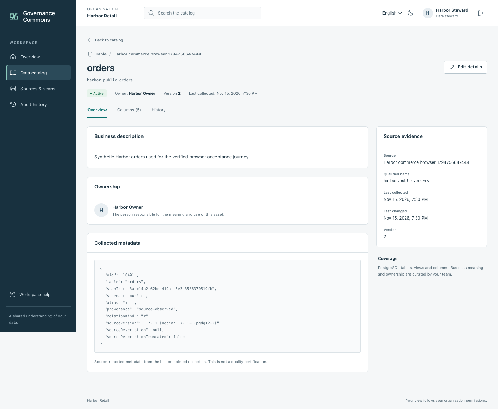

# Governance Commons

An independent open-source data and AI governance platform, built in one monorepo. Original code and synthetic examples only. Apache-2.0.

**Development in progress.** This repository preserves the full [product specification](docs/product/BUILD_SPEC.md), [machine-readable requirements](docs/product/requirements.yaml), and [current execution state](docs/execution/STATE.md). A catalog slice is an intermediate milestone; it does not represent the complete target or a supported enterprise release.

The first increment connects Keycloak login, tenant-scoped PostgreSQL persistence, Temporal/site/Python PostgreSQL metadata scans, OpenSearch discovery, ownership and audit. This core journey passes real local browser and isolation tests. PostgreSQL metadata is locally qualified; lineage, DQ and source grants remain open. The model workspace adds immutable typed definitions, a visual editor, schema import/export, complete bounded impact previews and explicitly pinned asset attributes. Attribute-model migrations now provide explicit bounded transformations, previews, atomic execution and immutable receipts. Inherited asset types are the next increment, with pinned parent versions, ownership constraints and lifecycle transitions; their current qualification is recorded separately. Full capabilities and enterprise deployment profiles are still being implemented.

```sh
./dev doctor
./dev bootstrap
./dev up --profile core
./dev seed --dataset harbor-demo
./dev test --suite smoke
```

Local application: http://localhost:4310. Bootstrap generates local credentials under ignored protected storage; never commit them. `./dev down` preserves data. Full/AI/enterprise profiles remain under implementation, and unsupported commands fail explicitly.

See [execution plan](docs/execution/PLAN.md), [release readiness](docs/release/READINESS.md), [capability traceability](docs/product/parity-matrix.md), [contributing](CONTRIBUTING.md), and [security](SECURITY.md). See the [executed evidence](docs/verification/evidence-manifest.json) and [inspected screenshots](docs/verification/screenshots/README.md). There is no external LLM or paid-service requirement for the core product.


