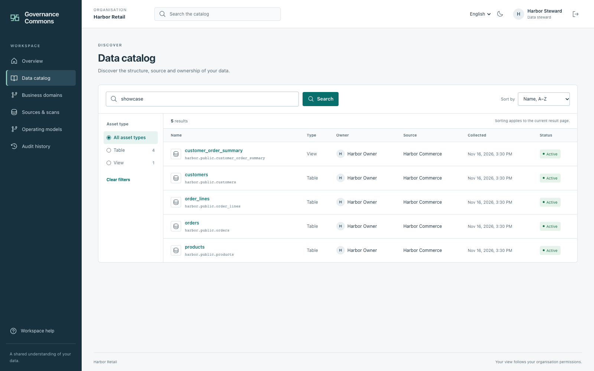
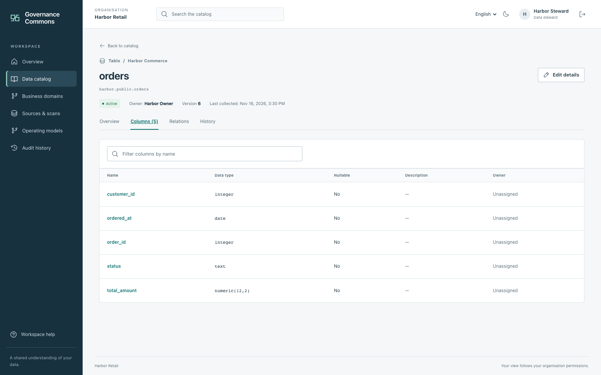
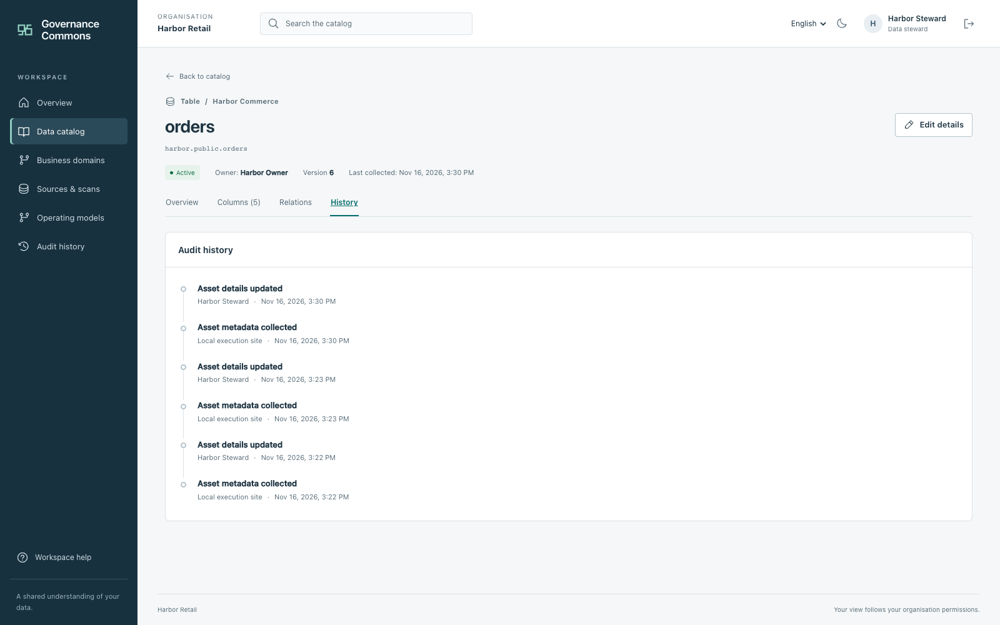

<p align="center"></p>

<p align="center"><a href="#run-it-locally">Run locally</a> · <a href="docs/product/STATUS.md">Product status</a> · <a href="docs/execution/PLAN.md">Delivery plan</a> · <a href="CONTRIBUTING.md">Contribute</a> · <a href="SECURITY.md">Security</a></p>

Governance Commons brings technical metadata, business context, ownership and change history into one self-hosted workspace. It is an independent [Apache-2.0](LICENSE) project with original code and synthetic examples.

**Development preview.** The core catalog and governance workflows run against real services. The broader programme and enterprise release gates remain in progress. See the [capability register](docs/product/requirements.yaml) and [release readiness](docs/release/READINESS.md) for exact implementation and verification status.

## Explore the workspace



*Actual application capture. Five synthetic tables and views were discovered by a real PostgreSQL scan; their descriptions and ownership were saved through the application API.*

<table><tr><td width="50%"><br><strong>From discovery to understanding</strong><br>Inspect source columns, provenance, ownership and governed context.</td><td width="50%"><br><strong>Understand what changed</strong><br>Trace collected metadata and stewardship changes in the asset history.</td></tr></table>

## What you can use today

| Workflow | Current development capability |
|---|---|
| Discover | Register a PostgreSQL source, run a real metadata scan, search assets, order all matching results across pages, restore browser navigation and inspect table, view and column metadata. |
| Steward | Assign owners, maintain descriptions, inspect change history and retain source provenance. |
| Model | Author versioned operating models, inherited asset types, lifecycle rules, constrained relations and typed business domains. |
| Change safely | Preview bounded model and graph migrations, detect stale versions and retain operation receipts. |
| Publish business meaning | Propose glossary terms and reference code lists, obtain independent approval, schedule effective releases and export governed reference values. |
| Trace and classify | Explore PostgreSQL view dependencies, review classification proposals and manage stable labels with retained evidence and immutable history. |
| Measure quality | Execute bounded PostgreSQL completeness, reference allowed-values, uniqueness, integer-range, latest-timestamp and table-volume checks with immutable rule versions and measurements. |
| Respond to quality issues | Schedule checks, acknowledge incidents, record remediation, verify recovery and retain reopening history. Expired freshness evidence cannot authorize resolution. |
| Collaborate securely | Keycloak OIDC login, server-side sessions, tenant-scoped API/database checks and append-only audit/outbox records. |
| Work in your language | English and Arabic layouts, light and dark themes, responsive views and scoped automated accessibility checks. |

These are scoped development capabilities. Passing one workflow does not qualify an entire enterprise release.

## Configurable identity and integrations

Microsoft Entra ID federation has an operator-configured OIDC broker path. The protected login/session lifecycle is tested separately with real local Keycloak; connecting it to the main application remains in progress. Entra tenant registration, tenant-specific claims and live Microsoft sign-in still require external qualification; account/group synchronization and the broader identity administration capability remain open.

Databricks Unity Catalog source registration and a metadata worker adapter are implemented in the development preview. Registration and missing-credential handling have local tests; a real Databricks workspace has **not** been qualified. Unity lineage, model registry, writeback and source permissions are separate remaining capabilities. PostgreSQL is the currently qualified real source path. The full [connector matrix](docs/product/connector-support.yaml) remains required.

The [product status](docs/product/STATUS.md) separates usable workflows from remaining implementation and qualification. Contracts, data products, source-access enforcement, notebooks, privacy, AI governance, semantic modelling, broader integrations and enterprise operations remain substantial work. Required features stay in the open-source project; there is no seat, asset or connector license gate.

## Run it locally

Install Docker with Compose and the [pinned development toolchain](CONTRIBUTING.md#set-up-and-check-a-change), then run:

```sh
pnpm install --frozen-lockfile
pnpm exec playwright install chromium
./dev doctor
./dev bootstrap
./dev up --profile core
./dev seed --dataset harbor-demo
./dev test --suite smoke
```

On Linux, install browser system libraries with `pnpm exec playwright install-deps chromium` before running acceptance tests. You can use an existing compatible browser by setting `GC_BROWSER_EXECUTABLE` to its executable path.

Open **http://localhost:4310**. Bootstrap generates synthetic development credentials in ignored local storage. `./dev down` stops the project while preserving data. The core requires no cloud account, paid service or LLM key. Profiles still under implementation fail explicitly instead of reporting an unexecuted success.

## Built for transparent engineering

React and TypeScript power the interface. Fastify and PostgreSQL own canonical state, with forced row-level security at tenant boundaries. OpenSearch serves search projections; Temporal coordinates work; TypeScript site runners and Python workers execute connectors. Keycloak supplies the local identity provider and SeaweedFS supplies local S3-compatible storage.

The [product specification](docs/product/BUILD_SPEC.md), [architecture decisions](docs/adr), [verification index](docs/verification/evidence-manifest.json) and [source code](apps) make scope and evidence inspectable. Screenshots show actual synthetic runtime data; they are not claims of unimplemented workflows, production certification or live vendor support.

Contributions are welcome through [issues](https://github.com/dlamaro96/governance-commons/issues) and [pull requests](https://github.com/dlamaro96/governance-commons/pulls). Start with [CONTRIBUTING.md](CONTRIBUTING.md). Report vulnerabilities privately using [SECURITY.md](SECURITY.md), and follow the [Code of Conduct](CODE_OF_CONDUCT.md).
