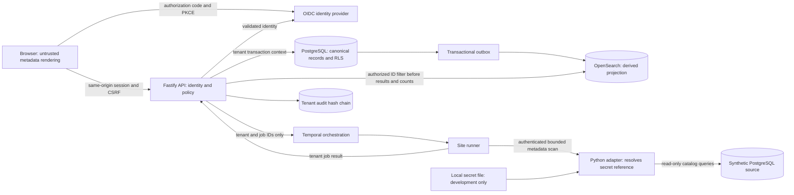

# Development threat model

Assessment date: 15 November 2026. Scope: the M1 working tree built on
`026611973a9fef5d02fb5a879beecf16fdcc44f3`, not an independently reviewed release.
This document distinguishes observed code, planned tests and executed evidence.
The canonical requirement and evidence registers remain authoritative for results.

The implemented slice authenticates people, scopes catalog metadata to tenants,
scans one synthetic PostgreSQL source, projects searchable metadata, assigns owners
and records changes. The complete product must also protect graph/vector retrieval,
objects, exports, notifications, approvals, plugins and AI execution. Those surfaces
are **not implemented or qualified by the slice**. Disabling an optional runtime
profile does not remove its implementation or security requirements.

## Assets and actors

Protected assets are source credentials, identity/session credentials, tenant
membership and policies, restricted metadata and asset existence, ownership and
workflow decisions, audit evidence, database backups and release identities.
Metadata names, counts and facets are confidential when the underlying asset is.
Synthetic local data is deliberately independent of employers and clients.

Adversaries include an unauthenticated visitor, a signed-in user of another tenant,
a tenant member without permission for a restricted asset, a malicious source or
connector payload, a compromised runner, a hostile pull request or dependency, and
an overprivileged operator. A trusted local operator may control development
containers and seed secrets; that trust is unsuitable for an internet-facing or
shared production deployment. Administrative privilege is not evidence that a user
should have unrestricted tenant content access.

## Data flow and boundaries

Every arrow crosses a distinct validation boundary. Derived indexes cannot grant
access independently of current canonical authorization. Worker possession of a
local bearer token does not authorize arbitrary tenant actions. Source identifiers,
column names, errors and descriptions remain untrusted even when returned by a
successful connector.

## Threats, current controls and residual work

| ID / threat | Observed implementation | Verification and residual work |
| --- | --- | --- |
| TM-01 Session theft, login substitution or fixation | `apps/api/src/security.ts:35` generates single-use expiring state, nonce and S256 PKCE. Callback validates RS256 issuer, audience, expiry, issued-at and nonce. Line 59 replaces the previous session with a random hashed-at-rest cookie session; HttpOnly, SameSite=Lax, 30 minutes and Secure in production. | Browser login/logout test exists in `tests/e2e/vertical-slice.spec.ts:16`. Negative issuer/audience/state/nonce, expired/replayed callback, cookie and logout-replay checks still need explicit evidence. IdP/backchannel revocation, group mapping and machine identity remain incomplete. |
| TM-02 CSRF, XSS, unsafe origins and redirects | `apps/api/src/security.ts:21` enforces exact configured Origin plus a timing-safe CSRF token for unsafe authenticated requests. `apps/web/src/api.ts:15` uses same-origin cookies and an in-memory CSRF token. React renders plain text. API Helmet/CSP, request bounds and redacted logging are installed in `apps/api/src/index.ts:12`. | Malicious-origin test exists in `tests/integration/foundation.test.ts:19`. Missing/wrong CSRF, stored/reflected metadata payloads, spoofed forwarding and runtime CSP tests need evidence. No rich-text/file-preview sanitizer is claimed. Production TLS/proxy headers need profile-specific qualification; local HTTP is an explicit development setting. |
| TM-03 Cross-tenant access and confused administration | `security.ts:15` rechecks identity/membership; tenant switching accepts only an active membership. `packages/db/src/index.ts:7` sets transaction-local tenant and actor. `packages/db/migrations/001_foundation.sql:18` forces RLS and composite tenant foreign keys. Runtime roles are separate from the owner and have no superuser/BYPASSRLS. | `tests/integration/foundation.test.ts:9` includes cross-tenant rows/inserts, FK and pool-reset cases. Global identities/sessions/login state and actor-scoped membership enumeration require continued review. Full RBAC/ABAC policy DSL, scoped elevation and every AT-TEN-01 boundary are incomplete. |
| TM-04 Restricted metadata leaked by search, counts or stale projection | `apps/api/src/repository.ts:9` filters canonical asset visibility; `apps/api/src/index.ts:33` determines authorized IDs before querying OpenSearch hits, totals and facets. Cursor signatures bind tenant, identity and query. | Stale restricted projection test is at `tests/integration/foundation.test.ts:36`. The current authorized-ID bound is 10,000 assets, a development limit. Graph/vector/export/object/MCP paths must receive equivalent filtering before activation. Audit views need the same asset confidentiality review. |
| TM-05 Source credential disclosure, SSRF or excessive source privilege | `python/governance_workers/server.py:9` resolves local secret references inside the adapter process. `postgresql.py:18` binds secret tenant, host/port/database/user and currently permits only the fixture host. Read-only transactions, timeouts, parameterized catalog queries, privilege rejection and output limits follow at line 28. | Tenant/destination unit cases and actual-source conformance tests exist in `python/tests`. Only the local synthetic destination is supported. Production vault/KMS integration, rotation/revocation, egress/DNS policy and mTLS/short-lived workload identities are required work. General URLs must not be enabled by relaxing the fixture allowlist. |
| TM-06 Queue impersonation, revoked authority and replay | `apps/workflow-worker/src/workflows.ts:3` carries tenant/job IDs only. Claim authorization is re-evaluated at `apps/api/src/index.ts:78`. Source creation and scans use request-bound idempotency. | Recheck authority at completion and every external effect, including changes after claim. Concurrent execution, lease expiry, retry after ambiguous response and cancellation need executable tests. Static development bearer tokens and internal HTTP are not production identity qualification. |
| TM-07 Audit tampering, disclosure and denied-action blind spots | `apps/api/src/repository.ts:11` serializes a tenant chain and appends audit/outbox within the caller transaction. Immutable triggers and revoked mutation privileges protect ordinary runtime access. `apps/api/src/audit.ts:13` explicitly limits the hash chain to local tamper evidence. | `tests/unit/audit.test.ts:6` covers envelope/chain changes; integration cases cover immutable records. Login/logout/denied-operation event coverage, restrictive audit visibility, signed external checkpoints/WORM, retention/legal holds and chain rotation are incomplete. A privileged database operator can rewrite a chain without an externally held checkpoint. |
| TM-08 Lost or duplicated mutation/projection effects | Asset edits use If-Match; transactional outbox claims and external search versions are in `apps/api/src/search.ts:11`. Failed scans change job state without retiring assets; successful reconciliation marks absence unavailable. | Inject rollback, worker crash, duplicate delivery, stale version and partial scan failure. Prove projections rebuild without granting access and that retry cannot duplicate external effects. Existing source inspection alone does not establish these behaviors. |
| TM-09 Parser, plugin and supply-chain compromise | The initial adapter has bounded requests and no arbitrary plugin loading. Actions use verified full commit pins, read-only PR permissions and a fail-closed required aggregate. Host dependency licensing and source/history secret scans have scoped records. | Sandboxed plugin execution, signed packages, parser bombs/path traversal/archive attacks, hosted SAST, dependency vulnerability scanning and artifact/OS SBOMs remain required. An open-source license check does not establish vulnerability safety. No release is qualified by a clean secret scan. |
| TM-10 Export, object, notification, AI and administrator exfiltration | These full-programme surfaces are not implemented by M1. Current UI cannot activate them. | Bind tenant, actor, permission version and expiry to jobs/URLs/caches; authorize every read/effect; redact logs; prevent model prompts and tools from widening permissions; enforce export retention and connector egress. Add adversarial cases before each surface is enabled. Preserve break-glass and recovery evidence without disclosing secrets. |
| TM-11 Resource exhaustion and recovery failure | API request/rate bounds and worker source query/output bounds exist. The local stack is intended for a single developer. | Per-tenant quotas, concurrency fairness, resilience/soak tests, backup restore and measured RPO/RTO, HA and workload isolation remain unqualified. Never infer production sizing from an idle Compose stack. |

Code line numbers above describe the initial review snapshot and can move as fixes
land. Record fixes and reruns in `docs/verification/evidence-manifest.json`; retain
history rather than rewriting the original observation as a prior pass.

## Verification basis and release limits

The target is applicable **OWASP ASVS 5.0 Level 2**, with selected stronger controls
for tenant isolation, source credentials, immutable evidence and release identity.
This is a target, not certification. The stable version was checked against the
[official ASVS release](https://asvs.owasp.org/downloads/) on 15 November 2026.
The preliminary [control map](asvs-map.md) is incomplete; every applicable control
requires a concrete test or manual evidence and disposition of every excluded
control. Independent penetration testing and manual production-profile checks are
pending. No vendor-live connector or enterprise qualification is claimed here.

Executed secret scanning is recorded in [secret-scan.json](secret-scan.json):
pinned gitleaks scans publishable files and all reachable Git history, produces
redacted locations only, and binds the source snapshot to a hash. It excludes
ignored local credentials and dependencies, and it cannot prove all possible
secrets absent. Rerun at the final release revision. The dependency report under
`docs/legal` covers the installed host development profile; release images,
Python packages, optional drivers and platform variants require their own gates.

A supported release additionally needs: complete applicable authorization tests,
manual security review and independent testing, qualified production transport and
identity/secret providers, backup/restore evidence, controlled dependency and
plugin distribution, artifact signing with exact identity/digest verification,
and remediation or time-bounded owner-approved disposition of known findings.
